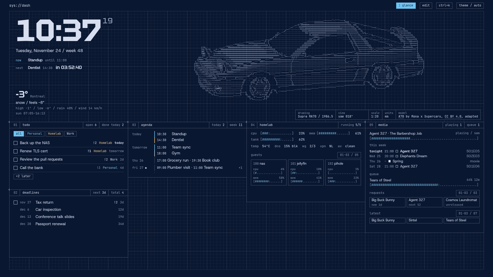

# dash

A one-screen dashboard for a homelab and a day: calendar, todos, time tracking, Proxmox, media, uptime and weather.
It is a SvelteKit app that runs on Node. Each panel fetches its own data on the server, so API keys stay there.



The screenshots use made-up data. On a phone the tiles stack: [phone screenshot](docs/screenshot-phone.png).

## Panels

| Panel | Shows | Needs |
| --- | --- | --- |
| clock | The time, the date and the ISO week, in the browser's time zone | Nothing |
| drawing | A 1986.5 Toyota Supra as an ASCII technical drawing that turns and locks into four views | WebGL2 in the browser |
| title block | The drawing's title block: view, scale, units, model credit | Nothing |
| now and next | The event happening now with its time left, and the next one with a countdown | `CAL_ICS` |
| weather | Temperature, feels like, wind, sky, high and low, rain chance, sunrise and sunset, from Open-Meteo. The place is a setting (default Montreal); add one panel per place. | Nothing (no key) |
| todo | Open cards from your vault's kanban boards, a tab per board; tick a card to mark it done | Gitea and vault keys |
| agenda | Today and tomorrow event by event, later days one line each, for 8 days | `CAL_ICS` |
| deadlines | All-day busy events of the next 60 days, with days left | `CAL_ICS`; the vault keys to tick them |
| focus | A timer per project, this week's hours and a weekly goal | Nothing; the vault keys for the project list |
| homelab | Proxmox CPU and memory, NAS pools, CPU temperature, DNS, WireGuard, VPN and antivirus, and a guest carousel | One pair of keys per line |
| media | What Jellyfin is playing, this week's episodes and movies, the download queue, open requests, the latest added | Sonarr and Radarr, Jellyfin, Jellyseerr keys |
| dev | Your Gitea repos with commits in the last 7 days, and CI runs that are not green | Gitea keys |
| uptime / 24h | The last 24 hours of checks, as one strip for all services, plus a row for each service that failed one | `links.json`; Proxmox keys for the guests |

A panel whose keys are missing shows `n/c`, and its tooltip names the keys. Everything else keeps working.

The `glance` preset shows every panel except focus, dev and uptime. Edit mode adds them. [DESIGN.md](DESIGN.md)
describes the board, the presets and how the page looks and moves.

The alerts panel lists what needs you: a link or a Proxmox guest down, a VPN leak or a bad VPN status,
an antivirus finding, an unhealthy or nearly full pool, a hot CPU, overdue todos, a failed CI run, a stuck download.
It only sees the answers that the panels on the page have fetched, and the uptime probes. It has no spot of its own:
edit mode adds it to a preset. The `refresh` button in the header (or `refresh` in Ctrl+K) makes every panel fetch
again, past the server's caches.

## Quick start

### With Node

You need Node 24 or later.

```sh
npm ci
cp .env.example .env                 # then fill in the keys you have
cp links.example.json links.json     # then list your own services
npm run build
npm start
```

The board is at http://localhost:3000. Settings, presets, the timer and the uptime history are kept in `dash.db`
(`DB_PATH`).

### With Docker

```sh
cp compose.example.yaml compose.yaml
cp .env.example .env
cp links.example.json links.json
docker compose up -d --build
```

The board is at http://localhost:3000. The database lives in the `dash-data` volume at `/data/dash.db`. If you have
no `links.json`, remove its line under `volumes`: Docker would mount a missing file as an empty folder.

### How `.env` is loaded

- `npm run dev` and `npm start` run Node with `--env-file-if-exists=.env`. A variable already set in the environment
  wins over the file.
- With Docker Compose, `env_file` passes `.env` to the container.
- `node build` alone does not read `.env`. Set the variables in the environment instead.
- Node reads `NODE_EXTRA_CA_CERTS` only from the real environment, before it reads `.env`. A line for it in
  `.env` is ignored by `npm start` and `npm run dev`. Export it in your shell or service. Docker Compose passes
  `.env` lines as real variables, so there it works; mount the file into the container too.

## Configuration

Every key is optional. Copy `.env.example` and fill in what you use. A panel shows `n/c` until its keys are set.

### General

| Key | Default | What it does |
| --- | --- | --- |
| `TZ` | The system's | The server's time zone: what "today" and "this week" mean for todos, the daily note, the timer and the calendar. The clock uses the browser's. |
| `DASH_NAME` | `SYS://DASH` | The name in the page title and, lowercased, in the header |
| `DB_PATH` | `dash.db` | The SQLite file. Its folder must exist. |
| `LINKS_FILE` | `./links.json` | The link list (see below) |
| `NODE_EXTRA_CA_CERTS` | None | A PEM file of extra CA certificates, for services with a private CA or a self-signed certificate. Real environment only (see above). |
| `HOST` | `0.0.0.0` | The address to listen on (adapter-node) |
| `PORT` | `3000` | The port to listen on (adapter-node) |

The other adapter-node variables work as well, such as `BODY_SIZE_LIMIT`, `SOCKET_PATH` and `XFF_DEPTH`.

### Calendar: now and next, agenda, deadlines

| Key | What it does |
| --- | --- |
| `CAL_ICS` | One or more ICS feed URLs, separated by spaces. The order only picks each feed's colour. |

- Recurring events are expanded. The agenda covers 8 days.
- A deadline is an all-day event that is not marked free (`TRANSPARENT`), within 60 days.
- A deadline whose title matches a done todo card is hidden. A matching open card gives it a priority and a tick box.
- A feed that fails is left out. The now and next panel says how many failed; the agenda and deadlines panels do not.

### Gitea and the vault: todo, deadlines, focus, dev, Ctrl+K

| Key | Default | What it does |
| --- | --- | --- |
| `GITEA_URL` | None | Your Gitea, such as `https://gitea.example.lan` |
| `GITEA_TOKEN` | None | A Gitea access token. It reads your repositories and writes to `VAULT_REPO`. |
| `VAULT_REPO` | None | The vault's repo, as `owner/name` |
| `VAULT_BOARDS` | `boards` | The folder of kanban boards in the vault |
| `VAULT_PROJECTS` | `wiki/projects` | The folder of project notes, the focus timer's project list |
| `VAULT_DAILY` | `wiki/daily` | The folder of daily notes, named `YYYY-MM-DD.md` |
| `GOAL_PROJECT` | None | The project with a weekly goal in the focus panel. No goal without it. |
| `GOAL_HOURS` | `10` | The weekly goal, in hours |

- Without `GITEA_URL` and `GITEA_TOKEN`, the todo and dev panels show `n/c`.
- Without `VAULT_REPO`, the todo panel shows `n/c`. Deadlines still show, without tick boxes. The focus panel
  still times projects, but has no project list.
- The dev panel lists the token user's repos (50 at most). The CI row needs Gitea Actions.

### Homelab

Each line of the panel has its own keys. A line without them shows `n/c`.

| Keys | Line | What it does |
| --- | --- | --- |
| `PVE_URL`, `PVE_TOKEN` | cpu, mem, guests | Proxmox VE, such as `https://192.168.1.2:8006`. The token is `user@realm!tokenid=secret`; a read-only role such as `PVEAuditor` is enough. The guests also show in uptime. |
| `GLANCES_URL` | temp | A Glances 4 server. The CPU temperature is the sensor whose label starts with `Package`, with its warning level. |
| `GLANCES_VMS` | guest mem | Optional. Space-separated `vmid=url` pairs of VMs that run Glances. Their memory is read there, because Proxmox counts a VM's page cache as used. |
| `GUARDS_URL` | vpn, av | A folder served over HTTP with `vpn-status.json` and `threat-status.json` (below). No trailing slash. |
| `PIHOLE_URL`, `PIHOLE_PASSWORD` | dns | Pi-hole v6 and its app password. Shows the share of queries blocked. |
| `TRUENAS_URL`, `TRUENAS_KEY` | pools | TrueNAS and an API key. The URL must be `https://`: TrueNAS revokes a key used over plain HTTP. |
| `WGDASH_URL`, `WGDASH_KEY` | wg | WGDashboard and an API key. Shows peers online of all. |

TrueNAS is reached with the certificate's chain checked but not its host name. A self-signed certificate needs
`NODE_EXTRA_CA_CERTS`.

`GUARDS_URL` is for a media stack that checks its own VPN and antivirus. dash reads these fields:

```json
// vpn-status.json
{ "status": "OK", "wan_leak": false, "containers": { "qbittorrent": "ok" }, "exit_country": "Iceland", "checked": "2026-01-01T12:00:00Z" }
// threat-status.json
{ "status": "CLEAN", "threats_total": 0, "last_threat": "", "last_scan": "2026-01-01T12:00:00Z" }
```

The VPN is fine when `status` is `OK`, `wan_leak` is false and every container is `ok`. The antivirus is fine
when `status` is `CLEAN`. When `checked` or `last_scan` is more than 20 minutes old, the banner says the guards are
stale.

### Media

| Keys | What it does |
| --- | --- |
| `SONARR_URL`, `SONARR_KEY`, `RADARR_URL`, `RADARR_KEY` | This week's episodes and movies, and the download queue. Both Sonarr and Radarr are needed. |
| `JELLYFIN_URL`, `JELLYFIN_KEY` | What is playing, and the latest added |
| `JELLYFIN_USER` | Whose "latest added" to show. Default: the first administrator. |
| `JELLYSEERR_URL`, `JELLYSEERR_KEY` | Open requests and their state. A request older than 7 days that is still missing is stuck. |

The API keys are in each app's settings. The media panel links to Sonarr, Jellyfin and Jellyseerr through
`links.json` entries named `Sonarr`, `Jellyfin` and `Seerr`. A stuck download in the banner links to the entry
named `qBittorrent`.

## links.json

A list of your services. Copy `links.example.json` to start.

```json
[
	{ "group": "fav", "name": "Jellyfin", "href": "https://jellyfin.example.lan", "icon": "jellyfin" },
	{ "group": "web", "name": "GitHub", "href": "https://github.com/", "icon": "github" },
	{ "group": "infra", "name": "NAS", "href": "https://192.168.1.11", "icon": "truenas-scale", "check": "http://192.168.1.11/" }
]
```

| Field | Required | Used by |
| --- | --- | --- |
| `name` | Yes | Ctrl+K; the uptime row; the alerts' "down" alert. The media panel and the alerts find services by name (see Media). |
| `href` | Yes | Ctrl+K opens it in a new tab. Uptime probes it, unless `check` is set. The "down" alert links to it. |
| `group` | Yes | The hint beside the name in Ctrl+K. Links in the group `web` are not probed. Other names are free. |
| `icon` | No | An icon name from [dashboard-icons](https://github.com/homarr-labs/dashboard-icons), shown in Ctrl+K and loaded from the jsDelivr CDN |
| `check` | No | The URL uptime probes instead of `href` |

- The file is read once, at startup. Restart dash after a change.
- A missing file means no links. A file that is not valid JSON stops the server with the error.
- Uptime probes each link every minute, 8 seconds at most, without following redirects. Any answer below 500 counts
  as up. History is kept for 7 days.
- The banner reports a link or guest as down only if it was up at some point in the last day. The panel shows the
  Proxmox guests as one row, `guests`, and leaves out guests that were not up in the last day.

## The vault

The todo panel, the deadlines tick box, Ctrl+K's `todo:` and `log:`, and the focus project list read and write a
Markdown vault in a Gitea repo. It matches the Obsidian Kanban plugin's format. dash reads and writes files through
the Gitea contents API, one commit per change.

### Boards

Each `.md` file in `VAULT_BOARDS` is a board; the file name is the board's name.

- A lane is a `## ` heading. Everything from a `%% kanban:settings` line on is ignored.
- A card is a line starting `- [ ] ` (open) or `- [x] ` (done).
- The lines under a card indented by a tab or two or more spaces are its description.
- dash reads a priority, a title and a due date from cards written like this:

  ```md
  - [ ] 🔴 **Title** · @{2026-12-01}
  ```

  The priority (`🔴`, `🟡` or `🟢`) and the `· @{date}` are optional. Any other card's title is the rest of the
  line.
- A done card counts as done today when its line ends with `✅ YYYY-MM-DD` and today's date.

Ticking a card rewrites it and moves it, with its description, to the top of the first lane whose name contains
"done" (else the last lane). The commit message is `dash: done <title>`.

```md
- [x] ~~🔴 **Title**~~ ✅ 2026-11-24
```

Adding a card (Ctrl+K, `todo: <text>`) appends it to the end of the first lane, with the commit message
`dash: add <title>`:

```md
- [ ] 🟢 **Title** · @{2026-12-01}
```

A board that does not exist yet is created with four lanes: `📥 Backlog`, `🏃 Sprint`, `🔨 In Progress`,
`✅ Done`.

### Quick add

`todo: <text>` reads these words out of the text; the rest is the title.

| Word | Meaning |
| --- | --- |
| `#name` | The board. An existing board matches without regard to case; a new name creates the board. Default: `Personal`. |
| `!1`, `!2`, `!3` | Priority `🔴`, `🟡`, `🟢`. Default: `🟢`. |
| `@today`, `@tomorrow`, `@+N` | Due today, tomorrow, or in N days |
| `@mon` … `@sun` | Due on the next such day, never today |
| `@YYYY-MM-DD` | Due on that date |

A board name is letters, digits, `_`, `-` and spaces, 40 characters at most. A title is cut to 200 characters.

### Daily notes

`log: <text>` adds `- <text>` to today's note, `VAULT_DAILY/YYYY-MM-DD.md`, after the last line of its first
section whose heading starts `## ` and contains "Work Log". dash does not create the note: without one it answers
`no daily note yet today`. The commit message is `dash: capture`.

### Projects

Each `.md` file in `VAULT_PROJECTS` is a project for the focus timer. Files whose names start with `_archived_` are
left out.

## Security

dash has no login. Anyone who can reach it can read everything it shows and can write to your vault, because it
writes through `GITEA_TOKEN`. Run it on a trusted LAN, or behind a reverse proxy that asks for a login.

## Behind a proxy, and private CAs

- adapter-node 6 has no `ORIGIN` variable, and dash needs none. SvelteKit's cross-site check skips POSTs with
  `Content-Type: application/json`, and every POST dash makes is JSON. So `PROTOCOL_HEADER` and `HOST_HEADER` are
  not needed either.
- Services with a self-signed certificate or a private CA need that CA in a PEM file named by
  `NODE_EXTRA_CA_CERTS`, set in the real environment (see How `.env` is loaded).

## Deploy example

`deploy/deploy.sh` is one way to deploy: to an Alpine LXC container on Proxmox, run by OpenRC.

1. In `.env`, set `DEPLOY_SSH` (the ssh host of the Proxmox node) and `DEPLOY_CT` (the container id).
2. In the container: install `nodejs` and `npm`, create a `dash` user and group, and create `/var/lib/dash`
   owned by `dash`.
3. Run `deploy/deploy.sh`.

The script writes `.env` to `/etc/dash.env` without the `DEPLOY_*` and `NODE_EXTRA_CA_CERTS` lines, and adds
`DB_PATH=/var/lib/dash/dash.db`, `HOST=0.0.0.0` and `PORT=3000`. It copies the working tree to `/opt/dash`,
untracked files such as `links.json` and `ca.pem` included, then runs `npm ci`, `npm run build` and
`npm prune --omit=dev` there. Last it installs `deploy/dash.openrc` as the `dash` service, enables it at boot and
restarts it.

`dash.openrc` runs `node --env-file=/etc/dash.env build` as `dash`, logs to `/var/log/dash.log`, and, when
`/opt/dash/ca.pem` exists, sets `NODE_EXTRA_CA_CERTS` to it. Put your CA bundle in `ca.pem` at the repo root if a
service uses a private CA.

## Development

```sh
npm run dev                    # the dev server, with .env loaded
npm run check                  # svelte-check and TypeScript
npm test                       # the unit tests (Vitest)
npm run panel -- <name>        # start a new panel
```

With Nix on x86_64 Linux, `nix develop` gives you Node 24. The `.envrc` does the same through direnv and also loads `.env` into
the shell.

To add a panel, see [DESIGN.md, Panels](DESIGN.md#panels). DESIGN.md also lists the checks to run after a change to
the car.

## Credits

- The car is adapted from ["Toyota Supra 2.5 GT Twin Turbo (A70)"](https://sketchfab.com/3d-models/toyota-supra-25-gt-twin-turbo-a70-6d002956a62a4e1085c6aab41b088ab1)
  by [Mona x Supercars](https://sketchfab.com/Car2022), licensed under
  [CC BY 4.0](https://creativecommons.org/licenses/by/4.0/). Changes: `scripts/bake_mesh.py` dropped the interior,
  the engine bay and hidden shells, grouped the materials into four tones, marked the parts that get their own
  outline and the headlamp pods, and packed the result into `src/lib/assets/supra.bin`. dash draws it as ASCII and
  line art.
- Fonts, all under the [SIL Open Font License 1.1](LICENSES/OFL-1.1.txt):
  [Host Grotesk](https://github.com/Element-Type/HostGrotesk),
  [JetBrains Mono](https://github.com/JetBrains/JetBrainsMono) and [Tektur](https://github.com/hyvyys/Tektur),
  through the `@fontsource-variable` packages.
- [GSAP](https://gsap.com) (with its Flip and ScrambleText plugins) is under GreenSock's
  [Standard "no charge" license](https://gsap.com/standard-license), which is not an open-source licence.
- The link icons come from [dashboard-icons](https://github.com/homarr-labs/dashboard-icons) through jsDelivr, at
  run time. They are not part of this repo.
- Weather data from [Open-Meteo](https://open-meteo.com).
- The other dependencies keep their own licences.

## Licence

MIT, see [LICENSE](LICENSE). The fonts and the car model keep their own licences, above.
